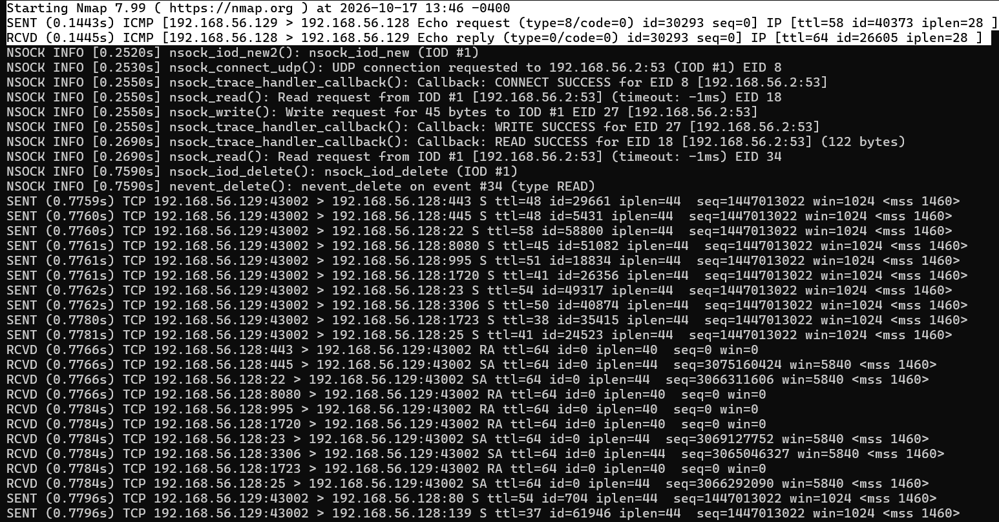
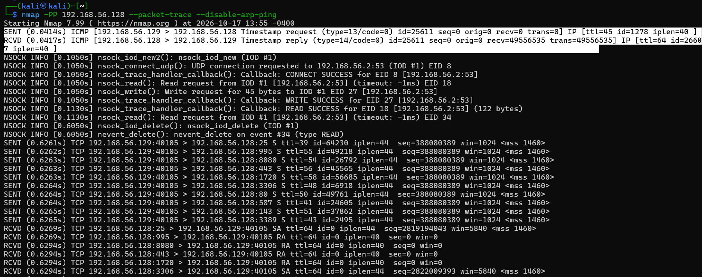
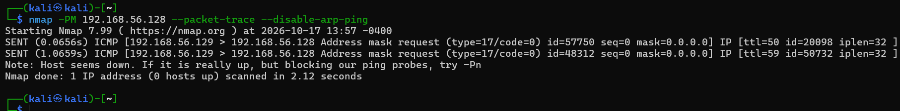
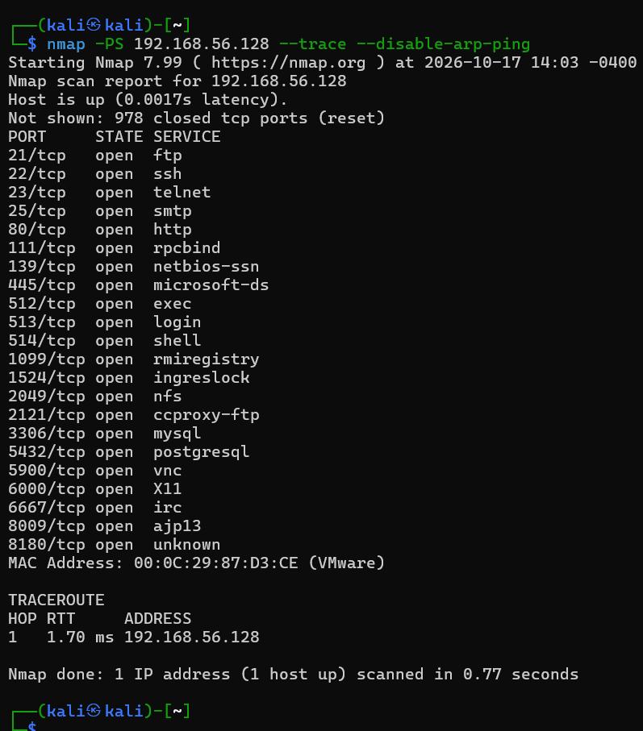

# A Host Discovery features using NMAP
To check which hosts are alive

#### a) ICMP sweep
##### Host discovery using ICMP
Host Send ICMP echo request (type=8 )
Response host send icmp echo reply(type 0) # target is alive
otherwise target is down

#### a) Broadcast ICMP 
ICMP echo request to a broadcast address
* most of the router block icmp echo request
* windows ignore icmp echo reqeust 

#### a) Non-Echo ICMP
two types
a) time stamp packet
icmp type 13

host response with the time stamp info

b) address mask request
icmp type 17
host respond with the subnet mask

#### a) TCP sweep

#### a) UDP sweep

