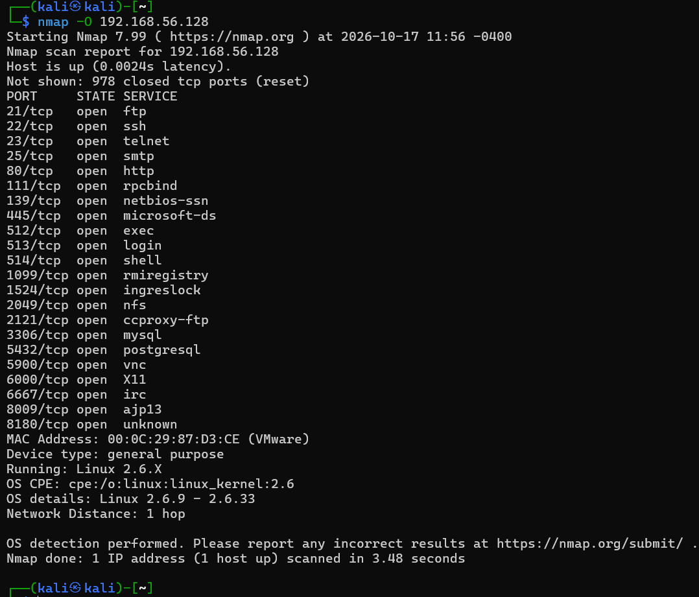
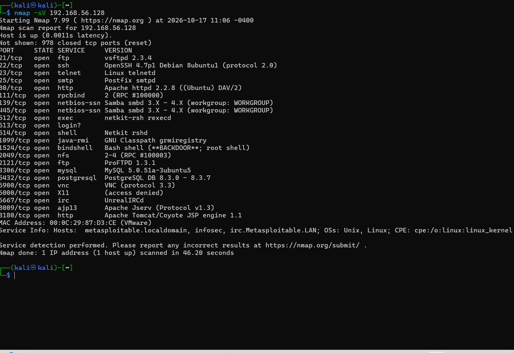
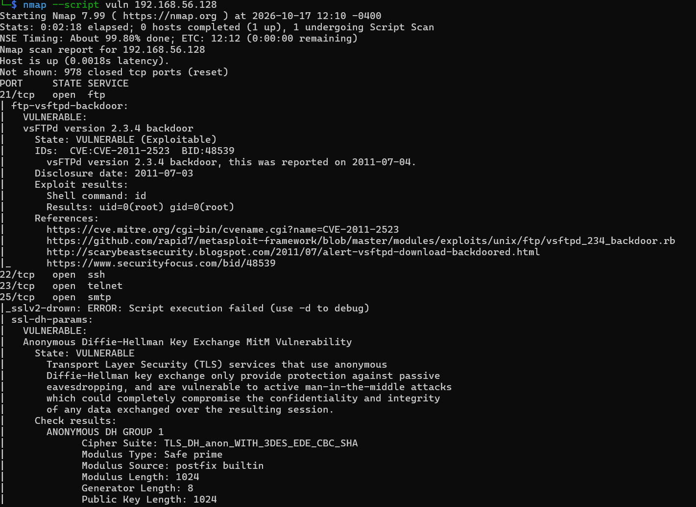
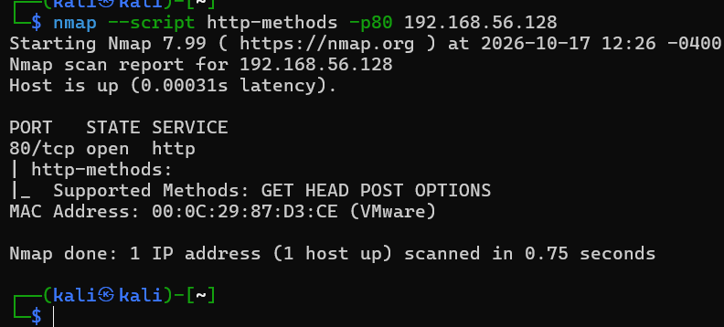
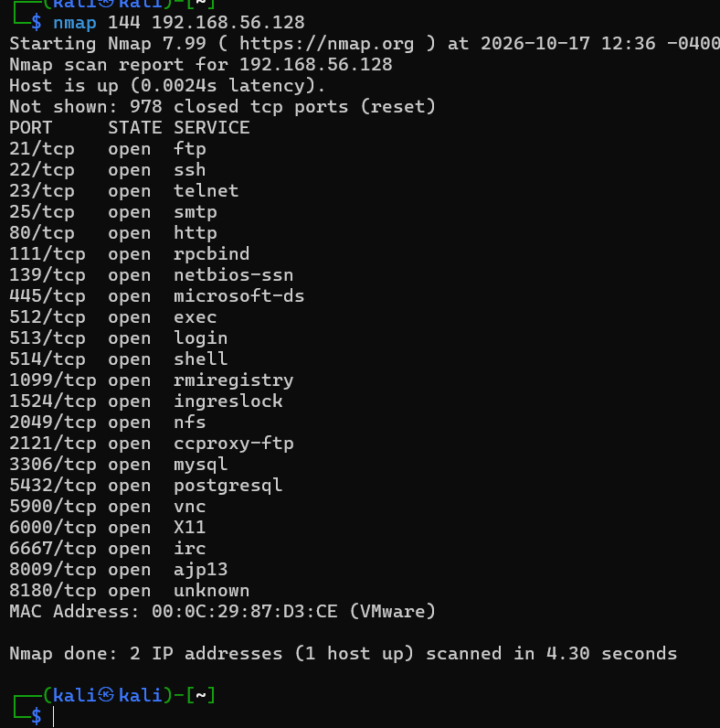

### NAMP Tool Re look 3
This were the lab experiments done using NMAP tools

NMAP OS discovery option
```bash
$nmap -o <ip_Address>
```

##### Host details, open ports, OS name, version of the OS including the release number
Output:


##### Detect the service versons using
if the service versions were known, can exploit the vulnerabilities in that version

````bash
$ nmap -sV 192.168.56.128
````


```bash
$ nmap -version-intensity 0 192.168.56.128
```
#### NMAP Scripts
custom scripts to perform specific operation such as service scan, port scan, etc

##### vulerability scan on a specific host
```bash
$ nmap --script vuln 192.168.56.128
```


##### detecting malware infection on a specific host

```bash
$ nmap -sV --script http-malware-host 192.168.56.128
```


```bash
$  nmap --script http-methods -p80 192.168.56.128 
```


```bash
$ nmap --script smb-brute.nse -p445 192.168.56.128
```


```bash
$ nmap 144 192.168.56.128
```

